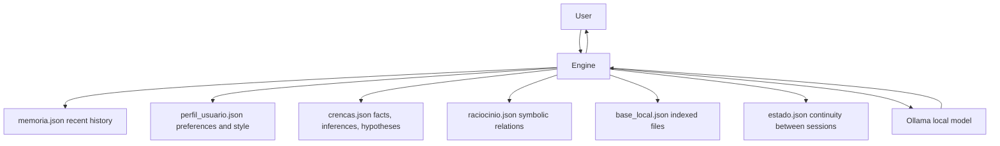

# Nolan

[🇧🇷 Português](README.md) | 🇺🇸 English

**A local, private AI assistant with its own memory.**

Nolan runs entirely on your machine — no cloud, no external API, no data leaving your PC. It combines a local language model (via Ollama) with its own layers of memory, beliefs, symbolic reasoning, and a knowledge base indexed from your own files.


---

## Table of contents

- [Overview](#overview)
- [Features](#features)
- [Cognitive architecture](#cognitive-architecture)
- [Presence and conversation modes](#presence-and-conversation-modes)
- [Requirements](#requirements)
- [Installation](#installation)
- [Running](#running)
- [Uninstalling](#uninstalling)
- [Local knowledge base](#local-knowledge-base)
- [Relational reasoning](#relational-reasoning)
- [Safe automation](#safe-automation)
- [Security and limits](#security-and-limits)
- [Project structure](#project-structure)

---

## Overview

Most AI assistants depend on external servers: your data travels over the internet, gets stored somewhere you don't control, and the system's behavior can change without notice. Nolan was built as an answer to that — an assistant that runs 100% locally, learns about you over time, and keeps everything in files that stay on your own machine.

It's not just a "chat with AI." It's a system with its own cognitive layers: recent and important memory, a user profile that evolves through conversation, a belief engine that separates facts from inferences and hypotheses, and a simple symbolic reasoner for logical relations.

## Features

**Interface and interaction**
- Desktop interface built with `customtkinter`
- Side cognitive panel with live memory, status, and local sources
- Local voice with `Piper` (Brazilian Portuguese) and automatic fallback to native Windows voices
- Speech listening using Windows' native speech recognition, when available

**Intelligence and memory**
- Local integration with Ollama — any model installed on your machine
- Recent memory and important memory, persistent across sessions
- User profile with conversation style and temporal patterns learned organically
- Belief engine with facts, inferences, and hypotheses, each with a confidence level
- Relational reasoning for simple equivalences (`A + B = C`, `X = Y`)

**Knowledge and automation**
- Local knowledge base — indexes and searches files from your own PC
- Basic automation with an explicit allow-list of actions (no arbitrary shell access)
- Automatic blocking of destructive or invasive requests

## Cognitive architecture

Nolan is split into independent layers, each persisted in its own file:



Every message passes through these layers before reaching the language model: the system assembles a private context with what it already knows about you, what has already been reasoned before, and what's relevant from your file base — all without ever exposing that "backstage" in the final reply.

## Presence and conversation modes

Nolan has a single public identity — it doesn't change names or present itself as different systems. Internally, though, it alternates between two postures:

| Mode | Behavior |
|---|---|
| `core` | Clear, stable, straight to the point |
| `shadow` | Observant, restrained, appears rarely and sparingly |

You can type `shadow` (or `ultron`, kept as an internal trigger) at the start of a sentence to pull out the observant side — but the reply always comes back identified as **Nolan**.

## Requirements

1. Python 3.11 or higher
2. [Ollama](https://ollama.com/download) installed and running
3. At least one local model downloaded, for example:

```powershell
ollama pull llama3
```

## Installation

On Windows, from inside the project folder:

```powershell
.\install.bat
```

This creates an isolated virtual environment in `.venv` and installs all dependencies from `requirements.txt` — without touching your machine's global Python.

<details>
<summary>Manual installation (alternative)</summary>

```powershell
python -m venv .venv
.venv\Scripts\pip install -r requirements.txt
```
</details>

## Running

```powershell
.\start_assistant.bat
```

Or, with the virtual environment already active:

```powershell
python main.py
```

## Uninstalling

```powershell
.\uninstall.bat
```

Removes the `.venv` virtual environment. The script also separately asks whether you want to delete the learned memory, profile, and beliefs — stored outside the project folder, in a system temp directory. This removal is optional and only happens with explicit confirmation.

## Local knowledge base

Through the interface, you can import files for Nolan to use as real context in its replies:

`.txt` · `.md` · `.py` · `.json` · `.toml` · `.yaml` · `.yml` · `.csv` · `.log` · `.ini` · `.cfg` · `.html` · `.css` · `.js` · `.ts` · `.tsx` · `.ps1` · `.bat`

Once indexed, the content can be searched directly from the side panel or used automatically as context in conversations.

## Relational reasoning

Nolan learns simple symbolic relations stated in conversation:

```
A + B = C
C = A + B
X = Y
```

Practical example:

```
You:   A + B = C
Nolan: Relation recorded. I can reuse this later.

You:   where does C come from?
Nolan: If we keep the recorded relation, C comes from A + B.
```

## Safe automation

Commands currently recognized:

- `abrir calculadora` (open calculator)
- `abrir bloco de notas` (open notepad)
- `abrir explorador` (open file explorer)
- `abrir navegador` (open browser)
- `que horas são` (what time is it)

All automation follows an explicit allow-list — nothing outside of it gets executed.

## Security and limits

The project runs in conservative mode by default:

- ❌ does not execute arbitrary shell commands
- ❌ does not delete files
- ❌ does not modify the Windows registry
- ❌ does not terminate processes
- ❌ does not shut down or restart the PC
- ❌ does not fake access to the internet, camera, or sensors that don't exist
- ✅ automatically blocks requests with destructive or invasive patterns

## Project structure

```
nolan/
├── main.py                  # entry point
├── install.bat               # installs dependencies into .venv
├── uninstall.bat              # removes .venv and, optionally, learned data
├── start_assistant.bat        # starts the assistant
├── requirements.txt
└── assistente_local/
    ├── app.py                 # application bootstrap
    ├── engine.py               # central orchestrator (the system's brain)
    ├── ui.py                    # desktop interface (customtkinter)
    ├── personas.py               # public identity and cognitive modes
    ├── memory.py                  # recent and important memory
    ├── profile.py                  # user profile and style
    ├── beliefs.py                   # facts, inferences, and hypotheses
    ├── reasoning.py                  # symbolic relational reasoning
    ├── knowledge.py                   # local knowledge base
    ├── planner.py                      # internal response planning
    ├── automation.py                    # allowed safe actions
    ├── safety.py                         # blocking of dangerous requests
    ├── speech.py                          # voice synthesis (Piper + Windows)
    ├── listener.py                         # speech recognition
    ├── state.py                             # continuity between sessions
    ├── config.py                             # settings and environment variables
    └── text_cleanup.py                        # generated text sanitization
```
