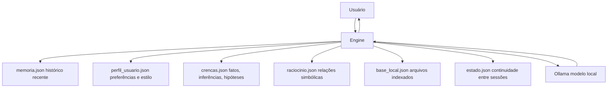

# Nolan

**Assistente de IA local, privado e com memória própria.**

Nolan roda inteiramente na sua máquina — sem nuvem, sem API externa, sem seus dados saindo do PC. Ele combina um modelo de linguagem local (via Ollama) com camadas próprias de memória, crenças, raciocínio simbólico e uma base de conhecimento indexada a partir dos seus próprios arquivos.


---

## Índice

- [Visão geral](#visão-geral)
- [Recursos](#recursos)
- [Arquitetura cognitiva](#arquitetura-cognitiva)
- [Presença e modos de conversa](#presença-e-modos-de-conversa)
- [Requisitos](#requisitos)
- [Instalação](#instalação)
- [Execução](#execução)
- [Desinstalação](#desinstalação)
- [Base de conhecimento local](#base-de-conhecimento-local)
- [Raciocínio relacional](#raciocínio-relacional)
- [Automação segura](#automação-segura)
- [Segurança e limites](#segurança-e-limites)
- [Estrutura do projeto](#estrutura-do-projeto)

---

## Visão geral

A maioria dos assistentes de IA depende de servidores externos: seus dados trafegam pela internet, ficam armazenados em algum lugar que você não controla, e o comportamento do sistema pode mudar sem aviso. Nolan nasceu como resposta a isso — um assistente que roda 100% localmente, aprende sobre você ao longo do tempo, e guarda tudo em arquivos que ficam na sua própria máquina.

Ele não é apenas um "chat com IA". É um sistema com camadas cognitivas próprias: memória recente e memória importante, um perfil de usuário que evolui com a conversa, um motor de crenças que separa fatos de inferências e hipóteses, e um raciocinador simbólico simples para relações lógicas.

## Recursos

**Interface e interação**
- Interface desktop construída com `customtkinter`
- Painel cognitivo lateral com memória, status e fontes locais em tempo real
- Voz local com `Piper` (pt-BR) e fallback automático para vozes nativas do Windows
- Escuta de fala usando o reconhecimento nativo do Windows, quando disponível

**Inteligência e memória**
- Integração local com Ollama — qualquer modelo instalado na sua máquina
- Memória recente e memória importante, persistentes entre sessões
- Perfil de usuário com estilo de conversa e padrões temporais aprendidos organicamente
- Motor de crenças com fatos, inferências e hipóteses, cada um com nível de confiança
- Raciocínio relacional para equivalências simples (`A + B = C`, `X = Y`)

**Conhecimento e automação**
- Base de conhecimento local — indexa e pesquisa arquivos do seu próprio PC
- Automação básica com lista explícita de ações permitidas (sem shell arbitrário)
- Bloqueio automático de pedidos destrutivos ou invasivos ao sistema

## Arquitetura cognitiva

Nolan é dividido em camadas independentes, cada uma persistida em seu próprio arquivo:



Cada mensagem passa por essas camadas antes de chegar ao modelo de linguagem: o sistema monta um contexto privado com o que já sabe sobre você, o que já foi raciocinado antes, e o que é relevante da sua base de arquivos — tudo isso sem nunca expor esse "bastidor" na resposta final.

## Presença e modos de conversa

Nolan tem uma identidade pública única — não muda de nome, não se apresenta como sistemas diferentes. Internamente, porém, ele alterna entre duas posturas:

| Modo | Comportamento |
|---|---|
| `core` | Claro, estável, direto ao ponto |
| `shadow` | Observador, contido, aparece raramente e com parcimônia |

Você pode digitar `shadow` (ou `raciocinar`, mantido como gatilho interno) no início da frase para puxar o lado observador — mas a resposta sempre volta identificada como **Nolan**.

## Requisitos

1. Python 3.11 ou superior
2. [Ollama](https://ollama.com/download) instalado e em execução
3. Pelo menos um modelo local baixado, por exemplo:

```powershell
ollama pull llama3
```

## Instalação

No Windows, dentro da pasta do projeto:

```powershell
.\install.bat
```

Isso cria um ambiente virtual isolado em `.venv` e instala todas as dependências do `requirements.txt` — sem afetar o Python global da sua máquina.

<details>
<summary>Instalação manual (alternativa)</summary>

```powershell
python -m venv .venv
.venv\Scripts\pip install -r requirements.txt
```
</details>

## Execução

```powershell
.\start_assistant.bat
```

Ou, com o ambiente virtual já ativado:

```powershell
python main.py
```

## Desinstalação

```powershell
.\uninstall.bat
```

Remove o ambiente virtual `.venv`. O script também pergunta, separadamente, se você quer apagar a memória, o perfil e as crenças aprendidas — guardados fora da pasta do projeto, em uma pasta temporária do sistema. Essa remoção é opcional e só acontece com confirmação explícita.

## Base de conhecimento local

Pela interface, é possível importar arquivos para que Nolan os use como contexto real nas respostas:

`.txt` · `.md` · `.py` · `.json` · `.toml` · `.yaml` · `.yml` · `.csv` · `.log` · `.ini` · `.cfg` · `.html` · `.css` · `.js` · `.ts` · `.tsx` · `.ps1` · `.bat`

Depois de indexado, o conteúdo pode ser pesquisado diretamente pelo painel lateral ou usado automaticamente como contexto nas conversas.

## Raciocínio relacional

Nolan aprende relações simbólicas simples ditas em conversa:

```
A + B = C
C = A + B
X = Y
```

Exemplo prático:

```
Você:  A + B = C
Nolan: Relação registrada. Posso usar isso depois.

Você:  de onde vem C?
Nolan: Se mantivermos a relação registrada, C vem de A + B.
```

## Automação segura

Comandos reconhecidos atualmente:

- `abrir calculadora`
- `abrir bloco de notas`
- `abrir explorador`
- `abrir navegador`
- `que horas são`

Toda automação segue uma lista de permissões explícita — nada fora dela é executado.

## Segurança e limites

O projeto roda em modo conservador por padrão:

- ❌ não executa shell arbitrário
- ❌ não apaga arquivos
- ❌ não altera registro do Windows
- ❌ não encerra processos
- ❌ não desliga ou reinicia o PC
- ❌ não finge acesso a internet, câmera ou sensores que não existem
- ✅ bloqueia automaticamente pedidos com padrões destrutivos ou invasivos

## Estrutura do projeto

```
nolan/
├── main.py                  # ponto de entrada
├── install.bat               # instala dependências em .venv
├── uninstall.bat              # remove .venv e, opcionalmente, dados aprendidos
├── start_assistant.bat        # inicia o assistente
├── requirements.txt
└── assistente_local/
    ├── app.py                 # inicialização da aplicação
    ├── engine.py               # orquestrador central (cérebro do sistema)
    ├── ui.py                    # interface desktop (customtkinter)
    ├── personas.py               # identidade pública e modos cognitivos
    ├── memory.py                  # memória recente e importante
    ├── profile.py                  # perfil e estilo do usuário
    ├── beliefs.py                   # fatos, inferências e hipóteses
    ├── reasoning.py                  # raciocínio relacional simbólico
    ├── knowledge.py                   # base de conhecimento local
    ├── planner.py                      # planejamento interno da resposta
    ├── automation.py                    # ações seguras permitidas
    ├── safety.py                         # bloqueio de pedidos perigosos
    ├── speech.py                          # síntese de voz (Piper + Windows)
    ├── listener.py                         # reconhecimento de fala
    ├── state.py                             # continuidade entre sessões
    ├── config.py                             # configurações e variáveis de ambiente
    └── text_cleanup.py                        # sanitização de texto gerado
```
